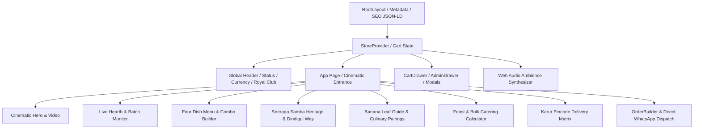

# SAMBALEAF Engineering & Architecture Reference (v2.0)

## 1. System Vision & Technical Philosophy
SAMBALEAF is an ultra-fast, culturally authentic web experience crafted for Dindigul-style Seeraga Samba Dum Biryani in Karur, Tamil Nadu. It blends culinary reverence with modern web performance (Next.js 14 App Router, TypeScript, Tailwind CSS, Web Audio API).

## 2. Component Hierarchy & Flow



## 3. Dedicated Routes
- `/`: Main interactive hearth experience.
- `/track`: Real-time order progress timeline from copper handi seal to doorstep delivery.
- `/heritage`: Deep-dive into Cauvery basin Seeraga Samba grain biology and history.
- `/sustainability`: Eco-packaging, plantain leaf polyphenols, and Karur clay handi return loop.
- `/halal`: 100% Zabiha Halal sourcing audit, Muslim butcher protocol, and alcohol-free kitchen guarantee.
- `/catering`: Wedding, corporate, and family feast booking calculator.

## 4. API Endpoints (Next.js App Router)
- `GET /api/menu`: Return curated dishes with optional `?category=` filter.
- `GET /api/status`: Real-time IST kitchen dum batch status and operating hours.
- `POST /api/orders`: Order validation, discount application, and ticket generation.
- `GET /api/reviews`: Verified customer testimonials and aggregate satisfaction rating.
- `POST /api/reviews`: Ingest customer dining feedback.

## 5. Automated Test Suite
Run tests with:
```bash
npm test
```
Tests cover:
- Core Currency & Portion formatters
- Menu data integrity & Halal compliance
- Customer input validation (Indian 10-digit mobile, address length)
- WhatsApp order URL builder
- Coupon discount engine (`SAMBAFIRST`, `KARURFEAST`)
- Royal Dum Club VIP loyalty tier calculations
- Multi-currency mathematical conversions
